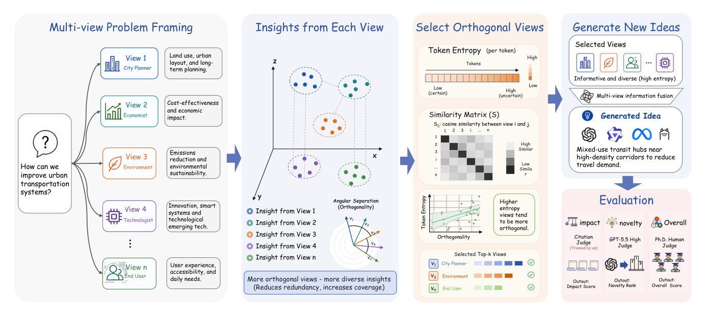
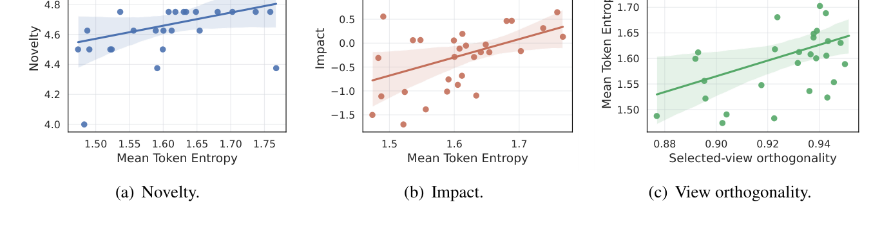
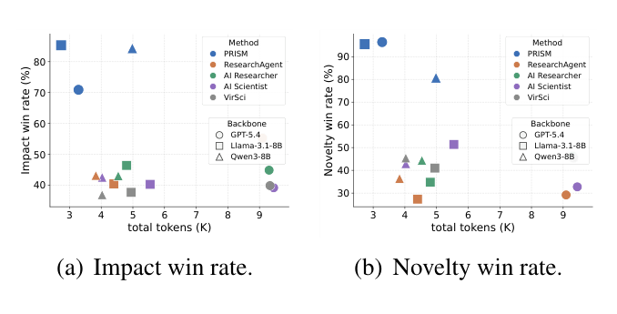
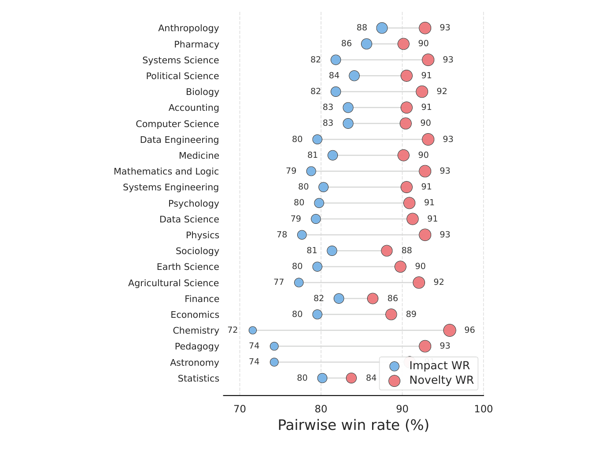
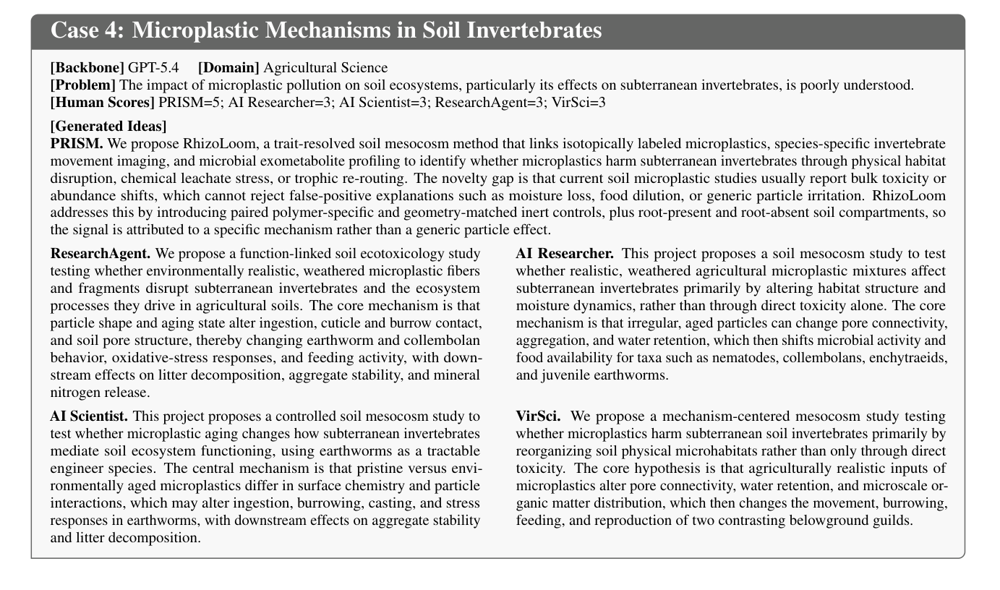

<div align="center">

# PRISM

### Entropy-Guided Multi-View Exploration for Scientific Idea Generation

**Explore complementary perspectives. Synthesize stronger scientific ideas.**

[](https://aclanthology.org/2026.emnlp-main.1180/)
[](https://aclanthology.org/2026.emnlp-main.1180/)
[](#quick-start)

Jiajun Yu, Weifan Mao, Kaipeng Zeng, Kejia Bian, Zhuo Wang, Kun Li, and Haishuai Wang

[Highlights](#highlights) · [Method](#method) · [Results](#results) · [Quick start](#quick-start) · [Citation](#citation)

</div>

---

PRISM explores a scientific problem through **complementary inspection views** before synthesizing a single proposal-style idea. The paper uses hypothesis-transition entropy to select orthogonal perspectives, helping the generator explore beyond a single line of reasoning.

## Highlights

- **Diversity at the reasoning stage.** Explore complementary views of the same research problem before writing the final proposal.
- **Entropy-guided view selection.** The paper selects views by hypothesis-transition entropy to encourage informative, nonredundant exploration.
- **Broad evaluation.** **500 problems**, **23 scientific domains**, **3 generation backbones**, and **7,500 generated ideas** across the compared methods.
- **Automated and human evidence.** The paper reports **80.2% impact pairwise win rate**, **90.9% novelty pairwise win rate**, and the highest human mean score, **3.91/5**.

## Method

<p align="center">
  
</p>

*Figure 1 from the paper.* PRISM constructs candidate views, estimates their complementarity, selects a subset, and conditions an idea-generation backbone on the selected perspectives.

> **Release scope.** The standalone script is a simplified generation interface using four fixed, risk-validated views. It accepts a caller-selected subset through `--selected-views`; it does not implement the paper's entropy estimator or automatic entropy-guided selection. The repository also provides generated ideas, judge outputs, and impact reward-model code.

## Results

| Reported measure | PRISM | Evaluation |
| :--- | ---: | :--- |
| Impact pairwise win rate | **80.2%** | Galactica-based impact discriminator |
| Novelty pairwise win rate | **90.9%** | GPT-5.5 blind five-way novelty ranking |
| Mean human score | **3.91 / 5** | Blind study with five PhD-level evaluators |

These are aggregate results reported in the paper across the evaluated backbones and baselines, not guarantees for an individual generated idea or a run of the simplified script. See the paper for the aggregation protocol and human-study sample.

<p align="center">
  
</p>

*Figure 2.* Analysis connects view entropy and complementary exploration to idea quality.

<details>
<summary><b>See the token-cost trade-off, domain robustness, and a qualitative example</b></summary>



*Figure 3.* Generation cost and pairwise performance across methods and backbones.



*Figure 11.* Domain-level pairwise performance against the compared baselines.



*Figure 10.* A soil-microplastic research problem from the human evaluation illustrates differences between generated proposals.

</details>

## Quick start

### 1. Install dependencies

```bash
pip install -r requirements.txt
```

Choose a configured Codex CLI backend or an OpenAI-compatible API backend. Model access and backend authentication are required.

### 2. Prepare a benchmark

Provide one JSON object per line. Each row needs `id`, `task_id`, or `benchmark_id`, plus `problem_statement` or `problem`:

```json
{"id":"example-001","domain":"Chemistry","problem_statement":"How can molecular optimization improve solubility while preserving the core scaffold?"}
```

Save your rows as `benchmark.jsonl`.

### 3. Generate ideas

With a configured Codex CLI:

```bash
python code/prism.py \
  --benchmark benchmark.jsonl \
  --output outputs/prism_generations.jsonl \
  --backend codex \
  --model gpt-5.4 \
  --limit 3
```

With an OpenAI-compatible API, set `OPENAI_API_KEY` in your environment, then run:

```bash
python code/prism.py \
  --benchmark benchmark.jsonl \
  --output outputs/prism_generations.jsonl \
  --backend openai \
  --model gpt-5.4 \
  --limit 3
```

By default, the script uses all four fixed views. Pass `--selected-views V1,V3` to supply a subset chosen by your own selection procedure. Output records use `method=prism` and `method_label=PRISM`.

## Repository guide

| Path | Purpose |
| :--- | :--- |
| [`code/prism.py`](code/prism.py) | Standalone idea generation |
| [`ideas/all_ideas.jsonl`](ideas/all_ideas.jsonl) | Released generated ideas |
| [`ideas/all_ideas.csv`](ideas/all_ideas.csv) | CSV mirror for inspection |
| [`ideas/summary_by_backbone_method.csv`](ideas/summary_by_backbone_method.csv) | Idea and token summaries |
| [`judges/`](judges/) | Novelty and impact judge outputs and summaries |
| [`impact_reward/`](impact_reward/) | Impact reward-model training, evaluation, and serving |
| [`assets/figures/`](assets/figures/) | Figures reproduced from the paper |

For impact judge setup, data requirements, and training commands, see the [reward-model guide](impact_reward/README.md).

## Citation

```bibtex
@inproceedings{yu2026prism,
  title     = {{PRISM}: Entropy-Guided Multi-View Exploration for Scientific Idea Generation},
  author    = {Yu, Jiajun and Mao, Weifan and Zeng, Kaipeng and Bian, Kejia and Wang, Zhuo and Li, Kun and Wang, Haishuai},
  booktitle = {Proceedings of the 2026 Conference on Empirical Methods in Natural Language Processing},
  year      = {2026},
  pages     = {27051--27072},
  url       = {https://aclanthology.org/2026.emnlp-main.1180/}
}
```
